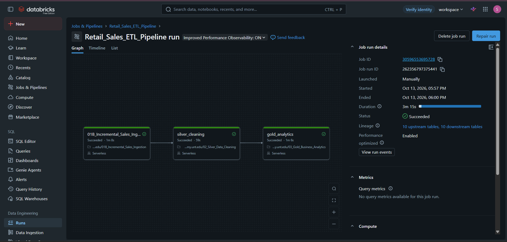
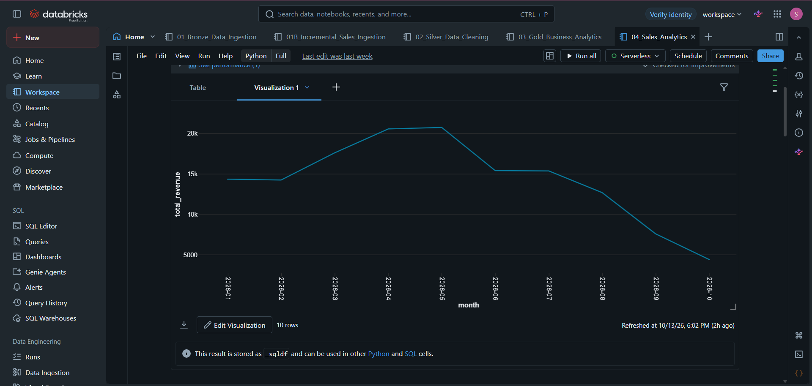
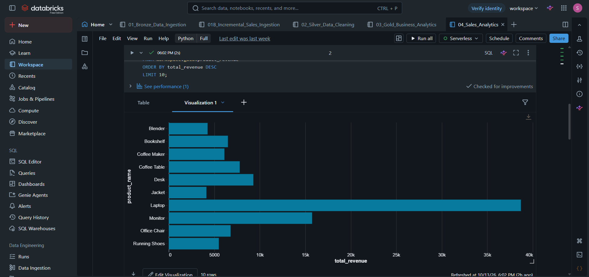
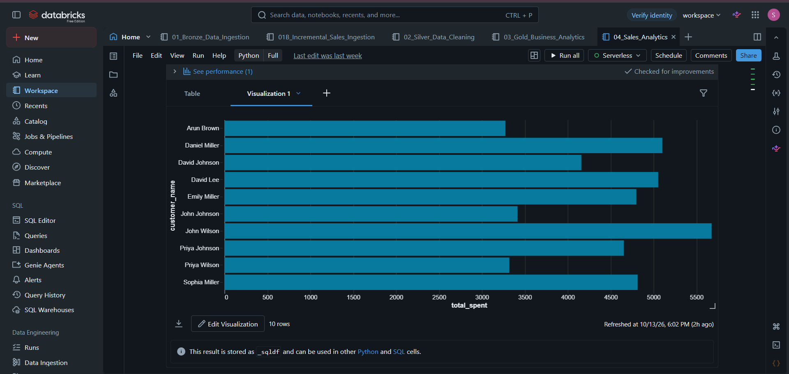

# Retail Sales ETL Lakehouse Pipeline using Databricks

**End-to-end retail data engineering project | Azure Blob Storage · Databricks · PySpark · Delta Lake · SQL**

## Project Overview

This project implements a retail sales ETL lakehouse pipeline using **Databricks** and the **Medallion Architecture (Bronze, Silver, Gold)**. It loads customer, product, and sales data from Azure Blob Storage, cleans and validates datasets with PySpark, processes new sales transactions incrementally using Delta Lake `MERGE`, and builds analytics-ready tables for business reporting.

A **Databricks file-arrival trigger** orchestrates incremental sales ingestion, Silver cleaning, and Gold aggregation when new files arrive in the incoming Databricks Volume.

## Project Results

| Metric | Verified result |
|---|---:|
| Cleaned customers | **100** |
| Cleaned products | **30** |
| Processed sales transactions | **527** |
| Sales referencing missing customers | **0** |
| Sales referencing missing products | **0** |
| Analytics-ready Gold tables | **4** |
| Databricks notebooks | **5** |

**Validation:** The Silver notebook completed a successful full run, and the automated Databricks workflow completed successfully. An incremental validation batch containing transaction IDs `T523`–`T532` was used to test downstream processing. These counts describe the verified project state, not ongoing live metrics.

## Architecture

```text
Initial load:
Azure Blob Storage (raw/customers.csv, products.csv, sales.csv)
                |
                v
     Bronze Ingestion Notebook
                |
                v
     Bronze Delta Tables
                |
                +-----------------------------+
                                              |
Incremental load:                             |
Incoming CSVs in Databricks Volume            |
                |                             |
                v                             |
      File-Arrival Trigger                    |
                |                             |
                v                             |
   Incremental Sales Ingestion                |
                |                             |
                v                             |
   Delta MERGE into Bronze Sales -------------+
                |
                v
        Silver Cleaning
                |
                v
        Silver Delta Tables
                |
                v
      Gold Business Analytics
                |
                v
        Gold Delta Tables
                |
                v
       Sales Analytics (SQL)
```

The initial Bronze load reads raw files from **Azure Blob Storage**. Incremental sales files are read from the **Databricks Volume** at `/Volumes/workspace/default/retail_sales_incoming/`.

## Technology Stack

| Area | Technologies |
|---|---|
| Cloud storage | Azure Blob Storage |
| Processing platform | Databricks, Apache Spark, PySpark |
| Lakehouse storage | Delta Lake |
| Data organization and governance | Unity Catalog |
| Querying and reporting | Spark SQL, SQL |
| Orchestration | Databricks Workflows, File Arrival Trigger |
| Source format | CSV |
| Programming | Python |

## Medallion Architecture

### Bronze — ingestion

Stores source customers, products, and sales in Delta tables. The initial ingestion notebook reads CSVs from Azure Blob Storage; sales are loaded using an insert-only Delta `MERGE` when the Bronze sales table already exists.

| Table | Purpose |
|---|---|
| `workspace.bronze.customers` | Customer source records |
| `workspace.bronze.products` | Product source records |
| `workspace.bronze.sales` | Sales transactions, including incremental inserts |

### Silver — cleaning and validation

Standardizes customer, product, and sales data; removes duplicate business keys; casts numeric and date fields; and checks for invalid values and unmatched customer/product references.

| Table | Purpose |
|---|---|
| `workspace.silver.customers` | Deduplicated customer records |
| `workspace.silver.products` | Deduplicated product records with numeric prices |
| `workspace.silver.sales` | Deduplicated sales with standardized quantity and date |

**Data-quality decision:** A product with a missing price is retained rather than discarded, because sales transactions reference that product. Its revenue remains `NULL` until a valid price is available. This preserves transaction coverage without inventing revenue.

### Gold — business aggregations

Joins Silver sales with products and customers using **left joins** to preserve sales transactions, calculates known revenue as `quantity × price`, and writes four reporting tables:

| Table | Business use |
|---|---|
| `workspace.gold.monthly_revenue` | Revenue trends by month |
| `workspace.gold.product_revenue` | Revenue by product |
| `workspace.gold.category_revenue` | Revenue by category |
| `workspace.gold.customer_spending` | Customer spending rankings |

Revenue calculations exclude unknown-price amounts from summed revenue rather than treating them as confirmed zero revenue.

## Notebooks

| Notebook | Role |
|---|---|
| [01_Bronze_Data_Ingestion.py](Notebooks/01_Bronze_Data_Ingestion.py) | Secure Azure connection and initial Bronze ingestion |
| [01B_Incremental_Sales_Ingestion.py](Notebooks/01B_Incremental_Sales_Ingestion.py) | Incoming CSV validation and insert-only Delta MERGE |
| [02_Silver_Data_Cleaning.py](Notebooks/02_Silver_Data_Cleaning.py) | Deduplication, standardization, quality checks, Silver tables |
| [03_Gold_Business_Analytics.py](Notebooks/03_Gold_Business_Analytics.py) | Joins, revenue calculation, and Gold aggregates |
| [04_Sales_Analytics.py](Notebooks/04_Sales_Analytics.py) | SQL queries for business analysis |

## Incremental Sales Ingestion

The incremental notebook:

1. Reads incoming CSV files from `/Volumes/workspace/default/retail_sales_incoming/`.
2. Converts `quantity` to a numeric type and standardizes sales dates.
3. Filters records missing required values or containing nonpositive quantities.
4. Deduplicates the incoming batch by `transaction_id`.
5. Uses **Delta Lake `MERGE`** to insert only transactions not already present in Bronze.
6. Validates total transaction counts and the latest sales date.

Simplified MERGE logic:

```sql
MERGE INTO workspace.bronze.sales AS target
USING new_sales_clean AS source
ON target.transaction_id = source.transaction_id
WHEN NOT MATCHED THEN
  INSERT (
    transaction_id, customer_id, product_id, quantity, sale_date
  )
  VALUES (
    source.transaction_id, source.customer_id,
    source.product_id, source.quantity, source.sale_date
  );
```

Matching transaction IDs are not inserted again, making repeated processing **idempotent with respect to those IDs**. Existing records are not updated by this MERGE.

### Mixed date formats

Incoming files may use `yyyy-MM-dd`, `M/d/yyyy`, or `MM/dd/yyyy` formats. The notebook tries each format and uses the first successful parse:

```python
from pyspark.sql import functions as F

new_sales_clean = new_sales_raw.withColumn(
    "sale_date",
    F.coalesce(
        F.expr("try_to_date(sale_date, 'yyyy-MM-dd')"),
        F.expr("try_to_date(sale_date, 'M/d/yyyy')"),
        F.expr("try_to_date(sale_date, 'MM/dd/yyyy')")
    )
)
```

## Workflow Automation

A **Databricks file-arrival trigger** watches the incoming Volume and launches the following workflow when new files arrive:

```text
01B_Incremental_Sales_Ingestion
              |
              v
       silver_cleaning
              |
              v
       gold_analytics
```

The Bronze initialization notebook is separate from the file-arrival workflow; the incremental job appends new sales to the existing Bronze sales table through MERGE.

## Business Analytics

The final SQL notebook queries the Gold tables to produce:

- **Monthly revenue trends** — `workspace.gold.monthly_revenue`
- **Top 10 products by revenue** — `workspace.gold.product_revenue`
- **Revenue by category** — `workspace.gold.category_revenue`
- **Top 10 customers by spending** — `workspace.gold.customer_spending`

These outputs can be viewed as tables and visualizations in Databricks.

## Data Validation

Checks performed across the pipeline include:

- Duplicate customer, product, and transaction identifiers
- Required fields and invalid values
- Quantity and date type conversion
- Sales with missing customer or product references
- Known versus unknown revenue caused by missing prices
- Row counts before and after joins
- Successful writes to Silver and Gold Delta tables
- End-to-end processing after incremental file arrival

Example validation query:

```sql
SELECT
    COUNT(*) AS total_bronze_sales,
    COUNT(DISTINCT transaction_id) AS unique_transactions,
    MAX(sale_date) AS latest_sale_date
FROM workspace.bronze.sales;
```

## Challenges and Solutions

| Challenge | Approach |
|---|---|
| Repeated incoming sales files | Deduplicate incoming IDs and use insert-only Delta `MERGE` |
| Mixed incoming date formats | Apply `try_to_date()` with multiple date patterns |
| Source and target schema differences | Cast quantity and date fields before MERGE |
| Missing product price | Retain product and sale; report unknown revenue as `NULL` |
| DataFrames referenced from SQL cells | Register temporary views with `createOrReplaceTempView()` |
| Manual downstream execution | Automate incremental ingestion, Silver, and Gold using Databricks Workflows |
| Protecting Azure access credentials | Retrieve the SAS token through Databricks Secrets instead of storing it in source code |

## Security Notes

The Bronze notebook retrieves the Azure SAS token using `dbutils.secrets.get()`. **Do not commit SAS tokens, storage account keys, or other secrets** to this repository. Access to Azure resources and Databricks objects requires your own configured permissions and credentials.

## Screenshots

### Successful Databricks ETL Workflow

The screenshot below shows the successful execution of all three automated pipeline tasks: Incremental Sales Ingestion, Silver Data Cleaning, and Gold Business Analytics.



### Monthly Sales Revenue

The chart below shows monthly sales revenue trends from January to October 2026.



### Top 10 Products by Revenue

The chart below shows the top 10 products by sales revenue, with Laptop generating the highest revenue, followed by Monitor.



### Top 10 Customers by Total Spending

The chart below shows the top 10 customers by total spending, with John Wilson generating the highest sales revenue.



## Running the Project

This repository contains Databricks notebook source files. To reproduce the workflow, you will need a Databricks workspace with the required permissions, access to an Azure Blob Storage container holding the source CSVs, a Databricks Secret scope for the SAS token, and an incoming Databricks Volume.

1. Configure the Azure connection and Databricks secret referenced by the Bronze notebook.
2. Import the notebooks into Databricks and confirm the `workspace` catalog and required schemas/Volume are available.
3. Run `01_Bronze_Data_Ingestion` to initialize the Bronze tables.
4. Run `02_Silver_Data_Cleaning`, then `03_Gold_Business_Analytics`.
5. Run `04_Sales_Analytics` to view reporting queries.
6. Configure a Databricks job with the incremental → Silver → Gold task dependency chain and a file-arrival trigger on the incoming Volume.

**Note:** Sample CSV data, cloud resources, secrets, and job configuration are not packaged in this repository; the notebooks require those dependencies to be set up separately.

## Future Enhancements

- Auto Loader for more scalable file ingestion
- Quarantine tables and formal data-quality expectations
- Schema evolution and monitoring/alerting
- Slowly Changing Dimensions (SCD)
- Databricks SQL dashboards and additional KPIs
- CI/CD and automated tests

## Author

**Sandeep Babu**  
Data Engineering Portfolio Project
